<p align="center">
  
</p>

<p align="center">
  <a href="https://github.com/ishandutta2007/Awesome-Awesome-Awesome"></a><a href="https://discord.gg/jc4xtF58Ve"></a>
  <a href="https://github.com/ishandutta2007/Awesome-Online-Document-Services/stargazers"></a>
  <a href="https://github.com/ishandutta2007/Awesome-Online-Document-Services/network/members"></a>
  <a href="https://github.com/ishandutta2007/Awesome-Online-Document-Services/issues"></a>
  <a href="https://github.com/ishandutta2007/Awesome-Online-Document-Services/blob/main/LICENSE"></a>
  <a href="https://makeapullrequest.com"></a>
  <a href="https://github.com/ishandutta2007"></a>
</p>

---

# 📑 Awesome Online Document Services

> 🌟 **The definitive, curated directory of Online Document Services, cloud PDF platforms, open-source document manipulation engines, and client-side WebAssembly toolkits.**

Whether you need enterprise-grade cloud e-signatures, high-throughput PDF conversion microservices, complete collaborative office suites, or zero-data-leakage client-side browser tools where files never leave your device, this guide catalogs the best SaaS products and open-source GitHub solutions.

---

## 🔍 SEO & Keyword Directory
* **Document Processing & Conversion:** Cloud PDF converter, headless Chromium to PDF, Office `.docx`/`.xlsx` to PDF, REST PDF API.
* **Editing & Manipulation:** Web PDF editor, page split and merge, page rotation, PDF compression, redaction, watermarking.
* **Document Management & Archival:** Self-hosted DMS, automated OCR indexing, document search, tag-based archiving.
* **Signatures & Forms:** Legal e-signatures, DocuSign open-source alternative, cryptographic verification, form filling.
* **Privacy & Architecture:** Browser-local WebAssembly (WASM), stateless Docker containers, air-gapped document toolkits.

---

## 📑 Table of Contents
- [🌐 Sector Overview & Market Dynamics](#-sector-overview--market-dynamics)
- [☁️ SaaS / Hosted Platforms](#️-saas--hosted-platforms)
- [💻 Open-Source GitHub Projects](#-open-source-github-projects)
- [🧭 Architecture Decision Matrix](#-architecture-decision-matrix)
- [🤝 How to Contribute](#-how-to-contribute)
- [⭐ Star History](#star-history)
- [⚖️ Disclaimer & Privacy Guidelines](#️-disclaimer--privacy-guidelines)

---

## 🌐 Sector Overview & Market Dynamics

The global **Digital Document & PDF Software market** is estimated at **$3.5B to $4.8B in 2026** (projected to exceed **$10B+ by 2033** at an estimated **12%–16% CAGR**), situated inside the broader **$9B+ Document Management System (DMS)** ecosystem. 

The sector displays a **bifurcated market structure**:
* **Enterprise Tier (Concentrated / Winner-Take-Most):** Dominated by entrenched global leaders like Adobe and DocuSign, driven by legal e-signature compliance (eIDAS, ESIGN, HIPAA, SOC 2), deep corporate workflow integrations, and enterprise IT procurement lock-in.
* **SMB & Self-Serve Web Tier (Moderately-to-Highly Fragmented):** A crowded arena of consumer web utilities (Smallpdf, iLovePDF, Sejda) competing alongside rapidly emerging **open-source, self-hosted, and browser-local WASM toolkits** (such as Stirling-PDF, BentoPDF, and Paperless-ngx) propelled by strict data sovereignty mandates (GDPR) and the desire to eliminate expensive recurring per-seat subscription models.

---

## ☁️ SaaS / Hosted Platforms

The following SaaS suites provide turn-key cloud document processing and e-signatures. Table is sorted by **Company Valuation / Annual Revenue (descending)**:

| 🏢 Platform & Provider | 💰 Valuation / Revenue | 🏷️ Starting Tier Pricing | 🎁 Free Tier / Trial Limit | ⚙️ Core Capabilities & Trade-Offs |
| :--- | :--- | :--- | :--- | :--- |
| **[Adobe Acrobat Online](https://www.adobe.com/acrobat/online.html)**<br>*(Adobe Inc.)* | **~$103B Market Cap**<br>*(FY2025 Rev: $23.8B)* | **$12.99 / mo**<br>*(Acrobat Standard, annual commitment billed monthly; or Pro at $19.99/mo)* | **Free Web Account**: 1 free task per 24h (up to 100MB limit for convert/compress, 200MB for Word-to-PDF). Free viewing, form filling & comments. **7-day free trial** for Acrobat Pro. | **The industry standard.** Unrivaled OCR and fidelity, cloud syncing, Creative Cloud integration. *Trade-off*: Proprietary cloud upload required; expensive desktop/enterprise licenses. |
| **[DocuSign eSignature](https://www.docusign.com/)**<br>*(DocuSign, Inc.)* | **~$14.2B Market Cap**<br>*(FY2026 Rev: $3.22B)* | **$10.00 / mo**<br>*(Personal Plan, annual commitment billed at $120/yr; or $15/mo monthly)* | **Free Signer Account**: Unlimited document signing and storage of incoming documents (**0 outbound sends**). Includes a **30-day free trial** with up to **5 envelope sends**. | **Gold standard for legal agreements.** Comprehensive audit trails, global compliance certifications, automated approval routing. *Trade-off*: Strict outbound envelope allowances; costly for high volume. |
| **[PandaDoc](https://www.pandadoc.com/)**<br>*(PandaDoc, Inc.)* | **$1.0B Valuation**<br>*(Series C Unicorn; $100M+ ARR)* | **$19.00 / user / mo**<br>*(Starter Plan, annual commitment billed at $228/yr; or $35/user/mo monthly)* | **Free eSign Plan (Forever Free)**: Exactly **5 document sends per month**, maximum **2 signers/recipients** per doc, up to 5 reusable templates, sandbox API. **14-day free trial** for Business tier. | **All-in-one document automation.** Combines CPQ, contract creation, proposal generation, and e-signatures. *Trade-off*: Integrations (Salesforce, HubSpot) locked to higher tiers. |
| **[Smallpdf](https://smallpdf.com/)**<br>*(Smallpdf AG)* | **~$80M–$100M Est. Valuation**<br>*(~$15M–$19M ARR; 50M+ MAU)* | **$9.00 / mo**<br>*(Pro Individual, annual commitment billed at $108/yr; or $15.00/mo monthly)* | **Free Forever Web Plan**: Strictly **2 document tasks per 24-hour period** (resets 00:00 CET), max **5 MB** file size for compressions, basic tools with web ads. **7-day free trial** of Pro. | **Streamlined browser utility.** Fast PDF conversion, merging, splitting, and signing with an intuitive UI. *Trade-off*: Files processed on remote servers; 2-task/day free limit is restrictive. |
| **[iLovePDF](https://www.ilovepdf.com/)**<br>*(ILovePDF S.L.)* | **~$50M–$75M Est. Valuation**<br>*(~$12M–$15M ARR; Bootstrapped)* | **$4.00 / mo**<br>*(Premium, annual commitment billed at $48/yr; or $9.00/mo monthly)* | **Free Forever Basic Plan**: Unlimited single-file conversions (file caps from **100 MB to 400 MB** depending on tool), batch processing restricted to **max 2 files**, web-only access. | **High-utility budget suite.** Extensive toolbox including OCR, HTML-to-PDF, watermark, and page numbering. *Trade-off*: Free tier is ad-supported and transmits files to external servers. |
| **[Sejda PDF](https://www.sejda.com/)**<br>*(Sejda BV)* | **~$20M–$30M Est. Valuation**<br>*(~$5M–$8M ARR; Bootstrapped)* | **$5.00** *(7-Day Web Pass)*<br>or **$7.50 / mo** *(Web Monthly recurring; or $63/yr Desktop+Web)* | **Free Forever Web Plan**: Up to **3 tasks per hour**, max **200 pages** or **50 MB** per document, OCR capped at **10 pages**, merge capped at **50 pages/files**. Auto-deletes files after 2h. | **Generous hourly allowances.** Robust online PDF text editing, form creation, and split/merge tools directly in the browser. *Trade-off*: Desktop client and batch workflows require paid upgrade. |

---

## 💻 Open-Source GitHub Projects

Open-source document applications allow organizations to retain **100% data privacy**, eliminate subscription costs, and deploy on-premise or run purely in-browser via WebAssembly.

Repositories are listed in **descending order by GitHub star count**:

### 1. 🥇 [Stirling-Tools/Stirling-PDF](https://github.com/Stirling-Tools/Stirling-PDF) [](https://github.com/Stirling-Tools/Stirling-PDF/stargazers)
* **Description:** The undisputed **#1 self-hosted PDF powerhouse** on GitHub. An open-core Java/Spring Boot application packaging **50+ tools in a single Docker container**.
* **Capabilities:** Merge, split, rotate, reorganize pages, perform multi-language OCR (100+ languages via Tesseract), convert Office/HTML/Markdown/images to PDF, redact sensitive text, apply watermarks, digitally sign, and repair corrupted files.
* **Deployment & Privacy:** Completely stateless by default — files are processed on your self-hosted instance and wiped instantly after completion. Desktop apps available for Windows, macOS, and Linux.
* **Docker Quickstart:** `docker run -d -p 8080:8080 frooodle/s-pdf:latest`

### 2. 🥈 [mozilla/pdf.js](https://github.com/mozilla/pdf.js) [](https://github.com/mozilla/pdf.js/stargazers)
* **Description:** The world's most widely deployed web-standard PDF parsing and rendering library, crafted and maintained by Mozilla.
* **Capabilities:** Renders Portable Document Format (PDF) files directly inside HTML5 canvas and SVG elements across any modern browser without native plugins.
* **Best For:** Developers embedding robust, responsive, and cross-platform PDF viewing into web applications.

### 3. 🥉 [paperless-ngx/paperless-ngx](https://github.com/paperless-ngx/paperless-ngx) [](https://github.com/paperless-ngx/paperless-ngx/stargazers)
* **Description:** A community-driven, supercharged document management system (DMS) that transforms stacks of physical paperwork into searchable digital archives.
* **Capabilities:** Automated ingestion from email, network shares, or scanners; parallelized optical character recognition (OCR); automatic tag, correspondent, and document-type classification using machine learning; full-text search with auto-complete.
* **Best For:** Home labs, legal offices, and small enterprises seeking a private, searchable digital file cabinet.

### 4. 📝 [docmost/docmost](https://github.com/docmost/docmost) [](https://github.com/docmost/docmost/stargazers)
* **Description:** Modern open-source collaborative wiki and knowledge-base management software built as an open alternative to Notion, Confluence, and Google Docs.
* **Capabilities:** Real-time multiplayer collaborative document editing, rich-text markdown-friendly formatting, hierarchical space management, permission control, and Dockerized deployment.
* **Best For:** Engineering teams and knowledge workers looking for collaborative document authoring without vendor lock-in.

### 5. 🛡️ [alam00000/bentopdf](https://github.com/alam00000/bentopdf) [](https://github.com/alam00000/bentopdf/stargazers)
* **Description:** The **privacy-first, client-side WebAssembly (WASM) PDF toolkit** featuring 130+ tools executed entirely within the user's browser.
* **Capabilities:** Merge, split, compress, watermark, rotate, annotate, OCR, and convert documents locally. No document is ever transmitted across the network — true zero-server exposure.
* **Deployment:** Deployable as static assets to Cloudflare Pages, Netlify, Vercel, or locally via Docker (`ghcr.io/alam00000/bentopdf-simple:latest`). Air-gapped environments supported.

### 6. ✍️ [documenso/documenso](https://github.com/documenso/documenso) [](https://github.com/documenso/documenso/stargazers)
* **Description:** The community-backed open-source alternative to DocuSign and Adobe Sign.
* **Capabilities:** Full digital e-signature lifecycle, custom signing templates, cryptographic signature sealing, automated reminders, webhook events, and REST API integration for automated signature workflows.
* **Tech Stack:** TypeScript, Next.js, Prisma, Tailwind CSS, deployable via Docker Compose.

### 7. 🚀 [gotenberg/gotenberg](https://github.com/gotenberg/gotenberg) [](https://github.com/gotenberg/gotenberg/stargazers)
* **Description:** A Docker-powered, stateless REST API for high-volume document conversion.
* **Capabilities:** Seamlessly converts HTML, Markdown, Word, Excel, PowerPoint, and images to PDF using headless Chromium, LibreOffice, and PDFtk. Includes PDF/A archiving and merging endpoints.
* **Best For:** Backend developers building SaaS apps that require programmatic, scalable PDF generation microservices.

### 8. 🐍 [py-pdf/pypdf](https://github.com/py-pdf/pypdf) [](https://github.com/py-pdf/pypdf/stargazers)
* **Description:** The classic, pure-Python library for reading, splitting, merging, cropping, transforming, encrypting, and decrypting PDF files.
* **Capabilities:** Zero external binary dependencies; extracts text and metadata; creates bookmarks; stamps watermarks; works across all standard Python environments.
* **Best For:** Python automated scripts, data science pipelines, and backend document manipulation.

### 9. ⚡ [pdfcpu/pdfcpu](https://github.com/pdfcpu/pdfcpu) [](https://github.com/pdfcpu/pdfcpu/stargazers)
* **Description:** High-performance PDF processing engine and command-line utility written in pure Go.
* **Capabilities:** Validates PDF compliance, extracts images and fonts, splits, merges, rotates, crops, watermarks, stamps, and optimizes PDF file structure for massive throughput.
* **Best For:** High-concurrency Go microservices, CLI power users, and serverless compute pipelines.

### 10. 📜 [Hopding/pdf-lib](https://github.com/Hopding/pdf-lib) [](https://github.com/Hopding/pdf-lib/stargazers)
* **Description:** Pure JavaScript/TypeScript PDF creation and mutation library built with zero native C/C++ dependencies.
* **Capabilities:** Create new PDFs from scratch, draw vector graphics and text, modify existing pages, embed PNG/JPEG images, and fill interactive PDF forms across Node.js, Deno, and web browsers.
* **Best For:** Fullstack JavaScript engineers needing client-side or serverless PDF assembly.

### 11. 🔏 [OpenSignLabs/OpenSign](https://github.com/OpenSignLabs/OpenSign) [](https://github.com/OpenSignLabs/OpenSign/stargazers)
* **Description:** Free and open-source electronic signature platform with built-in PDF document signer, form builder, and audit trail engine.
* **Capabilities:** Legally binding digital signatures, bulk sending, multi-party signing orders, reusable templates, and developer APIs.
* **Best For:** Small-to-medium businesses looking for an open-source DocuSign replacement with team management.

### 12. 🏢 [ONLYOFFICE/DocumentServer](https://github.com/ONLYOFFICE/DocumentServer) [](https://github.com/ONLYOFFICE/DocumentServer/stargazers)
* **Description:** Enterprise-ready collaborative online office suite featuring full-fledged document, spreadsheet, presentation, and native PDF editors.
* **Capabilities:** Real-time multi-user editing, PDF annotation and text editing, form creation, track changes, and out-of-the-box integration with Nextcloud, ownCloud, and Seafile.
* **Best For:** Organizations building private cloud office workspaces on sovereign infrastructure.

### 13. ✂️ [pdfarranger/pdfarranger](https://github.com/pdfarranger/pdfarranger) [](https://github.com/pdfarranger/pdfarranger/stargazers)
* **Description:** Minimalist, lightning-fast GTK desktop utility to visually merge, split, rotate, crop, and rearrange PDF document pages.
* **Capabilities:** Clean drag-and-drop graphical user interface powered by pikepdf; instant page reordering with zero learning curve.
* **Best For:** Desktop users wanting quick visual document rearrangement without bloated suites or online uploads.

### 14. 💻 [ranuts/document](https://github.com/ranuts/document) [](https://github.com/ranuts/document/stargazers)
* **Description:** Local-first browser document editor for Microsoft Word (`.docx`), Excel (`.xlsx`), PowerPoint (`.pptx`), and PDF files.
* **Capabilities:** Runs core document manipulation locally in-browser without Microsoft Office or cloud servers; PWA-installable, Docker deployable, and embeddable via iframe APIs.
* **Best For:** Web applications needing embedded Office and PDF editing with local-first security.

### 15. 📖 [mrmn2/PdfDing](https://github.com/mrmn2/PdfDing) [](https://github.com/mrmn2/PdfDing/stargazers)
* **Description:** Lightweight self-hosted PDF manager, reading position tracker, and annotation tool backed by Django and SQLite.
* **Capabilities:** Remembers last-read positions across devices, multi-level tagging and archiving, highlight annotations with note export, OIDC single sign-on, and secure QR-code share links.
* **Best For:** Researchers, students, and teams wanting a personal, lightweight digital PDF library.

### 16. ⚙️ [ComPDFKit/compdf-self-hosted](https://github.com/ComPDFKit/compdf-self-hosted) [](https://github.com/ComPDFKit/compdf-self-hosted/stargazers)
* **Description:** Docker-deployable PDF editing and conversion center with an administrative management console.
* **Capabilities:** Web UI for PDF editing (merge, split, rotate, watermark, encrypt) and conversion across PDF, Office, HTML, and images; includes API key monitoring and usage statistics.
* **Best For:** Enterprises seeking commercial SDK power packaged inside a self-hosted Docker deployment.

---

## 🧭 Architecture Decision Matrix

```
                                  [Document Processing Need]
                                              |
                   +--------------------------+--------------------------+
                   |                                                     |
       [Confidential / Strict Privacy]                       [Quick Convenience / Teams]
                   |                                                     |
         +---------+---------+                                 +---------+---------+
         |                   |                                 |                   |
   [Client-Only]       [Self-Hosted]                     [Free / Freemium]    [Enterprise Cloud]
         |                   |                                 |                   |
   • BentoPDF          • Stirling-PDF                    • iLovePDF          • Adobe Acrobat
   • ranuts/document   • Paperless-ngx                   • Smallpdf          • DocuSign
   • pdf.js            • Gotenberg / Documenso           • Sejda             • PandaDoc
```

* **Select Client-Side WASM (BentoPDF, ranuts/document):** When handling unredacted PII, medical records, financial statements, or classified documents where server uploads are strictly forbidden.
* **Select Self-Hosted Docker (Stirling-PDF, Gotenberg, Documenso):** When building scalable, automated backend services with zero recurring per-user fees and full infrastructure sovereignty.
* **Select Cloud SaaS (Adobe, DocuSign, PandaDoc):** When legally binding cross-border e-signature compliance (eIDAS, ESIGN) and deep corporate software integrations take priority.

---

## 🤝 How to Contribute

Contributions, project additions, and updates are warmly welcomed!

1. 🍴 **Fork the repository** on GitHub.
2. 🌿 **Create a new branch**: `git checkout -b feature/add-document-tool`
3. 📝 **Add or update entries** in `README.md` adhering to the standard format (include name, links, accurate pricing/star badges, and factual descriptions).
4. 🚀 **Commit your changes**: `git commit -m "Add New-Document-Tool to open-source list"`
5. 📤 **Push to branch**: `git push origin feature/add-document-tool`
6. 🎯 **Open a Pull Request** with a concise summary.

---

##  Star History

[](https://star-history.dera.page/#ishandutta2007/Awesome-Online-Document-Services&type=date&legend=top-left)

---

## ⚖️ Disclaimer & Privacy Guidelines

* This repository is a community-curated research index; inclusion does not constitute a formal commercial endorsement.
* **Cloud Security Warning:** Free online PDF converters (such as Smallpdf, iLovePDF, and Adobe Web) transmit documents to external servers. Avoid uploading unencrypted sensitive, proprietary, or regulated documents to public cloud web tools.
* **Resource Planning:** Self-hosted Java-based suites (like Stirling-PDF) require 1–2 GB RAM for production stability; high-throughput OCR workflows are CPU-intensive and should be scaled appropriately.

---

<p align="center">
  <sub>Maintained with ❤️ by <a href="https://github.com/ishandutta2007">Ishan Dutta</a> and the global open-source community.</sub>
</p>
